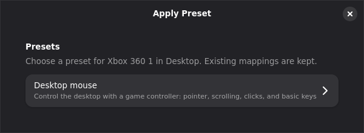
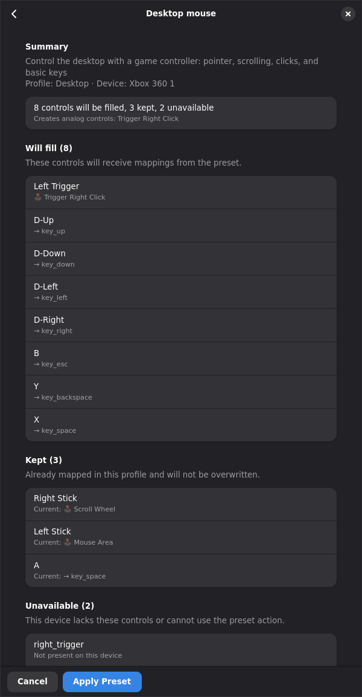

# Profile presets

This page covers presets that fill a profile with mappings. For presets that
describe a device's controls during setup, see
[Hardware presets](hardware-presets.md).

A profile preset is a TOML file that fills a device layer in a profile with a
ready-made set of mappings. Applying a preset is a one-time fill. After you
apply it, the profile holds ordinary mappings that you can edit or delete
freely, with no ongoing link to the preset file.

Keymasq ships with a bundled **Desktop mouse** preset
(`gamepad-desktop-mouse.toml`) that turns a game controller into a desktop
pointer, scroll wheel, click, arrow-key, and basic key layout.

## Applying a preset in the GUI

1. Open the tab for the device you want to configure and select the target
   profile in the profile dropdown.
2. Click the **Apply preset** button on the profile toolbar (next to the
   profile add, copy, and settings buttons).

   

3. Choose a preset from the list. Keymasq only lists presets that match the
   tab's hardware, with model-specific presets shown first.

   

4. Review the preview before confirming. It shows:
   - how many controls will be filled and the mapping each control will receive,
     plus any new saved analog controls that will be created
   - which controls are kept because they are already mapped in the selected
     profile
   - which controls in the preset are unavailable on this device

   

5. Click **Apply Preset** to write the mappings and reload the session. If
   nothing would be filled, the preview explains why and does not offer to apply.

The **Apply preset** button is disabled when **Passthrough** is selected (no
editable profile) or when no hardware is attached to the tab.

## Apply rules

Presets are additive and never overwrite existing user work:

- Only controls that are unbound or set to `passthrough` in the selected
  profile's layer for that device are filled.
- Any control that already has a non-passthrough mapping in that device layer is
  kept unchanged.
- If a preset references an analog control by name and a saved analog control
  with the same name already exists in `~/.config/keymasq/analog_controls/`,
  Keymasq reuses the saved analog control and does not overwrite it.
- If the saved analog control has a different `input_type` (`stick` vs `axis`)
  than the hardware control requires, that mapping is skipped as unavailable.
- Controls that the device does not have, or actions that do not fit the
  control type, are skipped as unavailable.

## Preset file format

A preset file is a `.toml` file with a `[preset]` header, `[mapping.<source_id>]`
tables using the same action syntax as [profile mappings](profiles.md), and
optional embedded `[analog_controls."<name>"]` tables using the same schema as
[Analog Controls](analog-controls.md).

```toml
[preset]
name = "Desktop mouse"
description = "Control the desktop with a game controller"
device_types = ["gamepad"]
# Optional list of vendor:product model IDs (case-insensitive)
# hardware = ["28de:1205"]

[mapping.right_stick]
action = "analog_control"
analog_control_name = "Mouse Move"

[mapping.btn_south]
action = "keyboard"
target = "key_enter"

[analog_controls."Mouse Move"]
input_type = "stick"
description = "Move the mouse with the stick"

[analog_controls."Mouse Move".mouse_motion]
enabled = true
speed = 1000.0
deadzone = 0.18
response_curve = 2.0
```

### `[preset]` fields

| Field | Required | Description |
| --- | --- | --- |
| `name` | No | Display name shown in the GUI. Defaults to the filename stem. |
| `description` | No | Short summary shown under the preset name. |
| `device_types` | No | List of evdev device types such as `["gamepad"]`, `["mouse"]`, or `["keyboard"]`. When omitted or empty, any device type matches. |
| `hardware` | No | List of `vendor:product` model IDs such as `["28de:1205"]`. Matching is case-insensitive. Presets with `hardware` set appear before generic presets. |

### `[mapping.<source_id>]` tables

Every preset must define at least one `[mapping.<source_id>]` table. Source IDs
match the button and analog input IDs from the device's hardware config
(for example `btn_south`, `right_stick`, or `left_trigger`). Mapping fields
follow the same syntax as `[devices."<hardware_id>".mapping.<source_id>]` in a
profile file.

### `[analog_controls."<name>"]` tables

When a preset maps a stick or axis with `action = "analog_control"`, it can
embed the analog control definition under `[analog_controls."<name>"]`. When the
preset is applied, Keymasq saves any embedded analog control that does not
already exist in `~/.config/keymasq/analog_controls/` before writing the
profile.

## Search folders and priority

Keymasq loads all `*.toml` preset files from the following directories, from
lowest to highest priority:

1. Bundled presets shipped inside the Keymasq package
2. `<dir>/keymasq/presets` for each absolute entry in `XDG_DATA_DIRS` (evaluated
   from last to first so earlier `XDG_DATA_DIRS` entries take priority, defaulting
   to `/usr/local/share:/usr/share`)
3. `~/.config/keymasq/presets` (or `$XDG_CONFIG_HOME/keymasq/presets`)

When two folders contain a preset file with the same filename stem, the higher
priority folder wins. This lets you override a bundled or system preset by
placing a file with the same name in `~/.config/keymasq/presets`. Invalid preset
files are logged and skipped without hiding valid presets.

## Trusting preset files

A preset can contain any mapping a profile can, including `exec` actions that
run shell commands when you press the mapped control. Read a preset file from
someone else before you apply it. The preview lists every mapping the preset
will add.

## Current limits

- A preset cannot reference a saved superkey, motion control, or macro. Files
  containing `superkey`, `motion_control`, or `macro` mappings are rejected
  during loading.
- Only hardware buttons, sticks, and axes are supported. Motion sensors and
  pointer movement mappings are not supported in presets.
